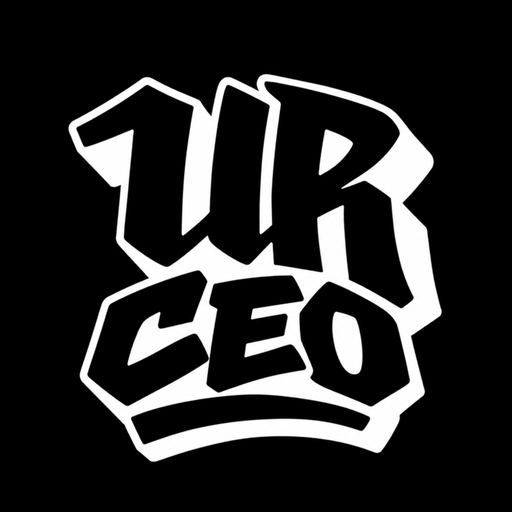

<p align="center">
  
</p>

<h1 align="center">FMS CEO</h1>
<p align="center"><b>Sé el CEO de la FMS.</b> Un manager de batallas de freestyle al estilo Football Manager.<br>
Juego de fans · gratuito · sin ánimo de lucro · funciona sin internet</p>

---

## 🎮 Descargar y jugar

### Windows
1. Ve a **[Releases](../../releases)** y descarga **`FMS_CEO.exe`**.
2. Haz doble clic. No hace falta instalar nada (la primera vez tarda unos segundos en abrirse).

> ⚠️ Como el juego no está firmado digitalmente, Windows puede mostrar *"Windows protegió su PC"*.
> Pulsa **"Más información" → "Ejecutar de todas formas"**.

### Navegador (Windows, Mac, Linux)
Descarga el **`index.html`** de la sección Releases (lleva todo dentro) y ábrelo con Chrome, Edge, Firefox o Safari. Funciona sin internet.

Si en vez de eso descargas el código del repositorio, abre su `index.html`: carga las imágenes, las fuentes y el código desde las carpetas `assets/`, `css/` y `js/`, así que mantenlas juntas.

### 📱 Android / iPhone (se juega en horizontal)
1. Abre la web del juego: **https://medsterrm.github.io/FMS_CEO/** (GitHub Pages).
2. **Android (Chrome):** menú ⋮ → **"Instalar aplicación"** (o "Añadir a pantalla de inicio").
   **iPhone (Safari):** botón Compartir → **"Añadir a pantalla de inicio"**.
3. Ábrelo desde el icono: se abre a pantalla completa y en horizontal, como una app. Tras la primera carga funciona sin internet.

> Si tienes el móvil en vertical, el juego te pedirá que lo gires.

## 💾 Partidas
- La partida se guarda sola.
- Desde el juego puedes **exportar** la partida a un archivo e **importarla** en otro ordenador o navegador.
- En el ⚙️ (arriba a la derecha) puedes **reiniciar el juego** y **añadir tus propios competidores** (nombre, nacionalidad, foto y estilo).

## 🏆 Qué incluye
- **Ligas nacionales**: España, Argentina, México, Chile, Perú, Colombia y Caribe, más la **FMS Internacional** y la **FMS World Series**.
- **Más de 470 freestylers** reales, cada uno con su nivel, fama, hype y estilo (Punchline, Ingenio, Métrico, Flow, Showman, Disonante, Teatral, Coherencia, Poético).
- **Jornadas en directo** con formato corto y largo (Easy, Hard, Temáticas, Random, Minutos, Deluxe), réplicas y PTB.
- **Red Bull Batalla** (nacionales, Torneo de Plazas e Internacional) y **competiciones Under** (Monster Fu, Cuna de Oro, General Rap, BDM…).
- **Gestión de la empresa**: estrellas, fichajes, salarios, patrocinadores, speakers/hosts, exhibiciones, calendario y visitas.
- **Eventos únicos**: rechazos, bajas, rivalidades, polémicas, edits de Ryker, streamers…
- **Twitter/X dentro del juego**: la comunidad reacciona a los line ups, a los cruces de cada jornada y a los campeones, con más de 180 tuiteros reales y su forma de hablar según el país.

## 🌐 Activar la web en GitHub (para jugar en móvil)
1. En tu repositorio: **Settings → Pages**.
2. En *Branch* elige **`main`** y carpeta **`/ (root)`** → **Save**.
3. En 1-2 minutos el juego estará en `https://medsterrm.github.io/FMS_CEO/`.

## 🤖 App de Android (Android Studio)
El proyecto está en la carpeta **`android/`**. Es una app que abre el juego a pantalla completa y siempre en horizontal, sin internet.

1. Abre **Android Studio → File → Open** y elige la carpeta `android`.
2. Espera a que termine *Gradle sync* (la primera vez descarga cosas, tarda unos minutos).
3. Para probar: conecta el móvil con *Depuración USB* activada y pulsa ▶️ **Run**.
4. Para sacar el APK: **Build → Build App Bundle(s) / APK(s) → Build APK(s)**. Sale en `android/app/build/outputs/apk/debug/app-debug.apk`.

> Si cambias el juego, genera el `index.html` único con `npm run build:single`, cópialo de `dist/index.html` a `android/app/src/main/assets/index.html` y vuelve a compilar.

## 🛠️ Compilar el .exe tú mismo (opcional)
Necesitas [Node.js](https://nodejs.org/) instalado.

```bash
npm install
npm start           # abre el juego en una ventana
npm run build:win   # genera dist/FMS_CEO.exe
npm run build:single # genera dist/index.html con todo incrustado, para publicar
npm run simular      # simula 1.000 temporadas y 4.000 cuadros con el motor del juego, 20 temporadas de relevo generacional y 20 años del mundo sin CEO en modo carrera y en modo CEO con medida del guardado ligero (menos de 1,5 MB), la poda sin pérdidas, la migración y la estabilidad de la fama y los salarios del pool a 20 años, comprueba los dos modos de partida y sus guardados, corre 10 mundos de carrera con un jugador pasivo y uno activo por país para medir la escalera, recorre una carrera fecha a fecha comprobando las pausas «Tu batalla» y el registro sin empresa, mide la repetición de los tuits y las redes de la carrera, cuenta las batallas por temporada del jugador con el circuito local, los torneos extra con liga y las exhibiciones, mide el descanso y el mercado (ofertas extranjeras, cambios de país y dinero) (--semilla N, --formato long, --cuadros N, --progresion N, --carrera N, --carreras N, --fechas N)
```
> Compílalo desde Windows. En Linux/Mac, `electron-builder` necesita Wine para poner el icono al ejecutable.

## 📁 Archivos
| Archivo | Qué es |
|---|---|
| `index.html` | Página del juego; carga `css/`, `js/` y `assets/` |
| `js/game.js` | Todo el código del juego |
| `js/images.js` | Rutas de fotos, logos y emojis |
| `js/mapas.js` | Mapas de sedes de cada país |
| `css/style.css` | Estilos y fuentes |
| `assets/` | Imágenes y fuentes (woff2) |
| `tools/build-single.js` | Genera el `index.html` único con todo incrustado |
| `tools/simular.js` | Simulación de temporadas para calibrar el motor de batallas |
| `main.js` | Ventana de escritorio (Electron) |
| `package.json` | Configuración para compilar el `.exe` |
| `manifest.webmanifest` | Configuración de la app para móvil (pantalla completa, horizontal, icono) |
| `sw.js` | Hace que el juego funcione sin internet en el móvil |
| `build/` | Iconos del juego |
| `android/` | Proyecto de Android Studio (app para móvil) |
| `AVISO_LEGAL.md` | Aviso de juego de fans |

## 🐛 Fallos y sugerencias
Escríbeme por X: **[@MedsterRM](https://x.com/MedsterRM)**. ¡Gracias por jugar!

## ⚖️ Aviso
Proyecto **hecho por fans, gratuito y sin ánimo de lucro**. No está afiliado a FMS, Urban Roosters, Red Bull ni a ninguna de las personas o marcas que aparecen. Todas las marcas e imágenes pertenecen a sus propietarios. Más detalles en [AVISO_LEGAL.md](AVISO_LEGAL.md).
