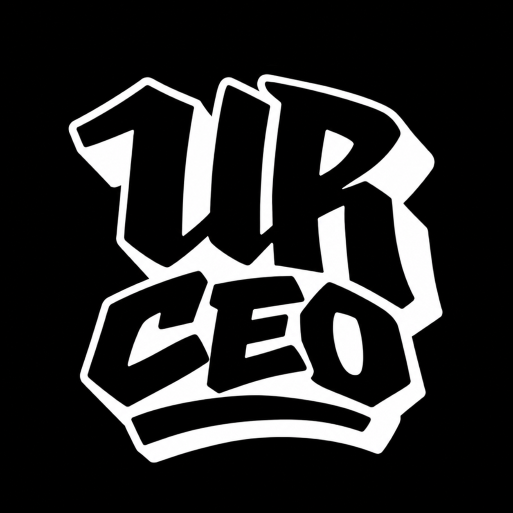

<p align="center">
  
</p>

<h1 align="center">FMS CEO</h1>
<p align="center"><b>Sé el CEO de la FMS.</b> Un manager de batallas de freestyle al estilo Football Manager.<br>
Juego de fans · gratuito · sin ánimo de lucro · funciona sin internet</p>

---

## 🎮 Descargar y jugar

### Windows
1. Ve a **[Releases](../../releases)** y descarga **`FMS_CEO.exe`**.
2. Haz doble clic. No hace falta instalar nada (la primera vez tarda unos segundos en abrirse).

> ⚠️ Como el juego no está firmado digitalmente, Windows puede mostrar *"Windows protegió su PC"*.
> Pulsa **"Más información" → "Ejecutar de todas formas"**.

### Navegador (Windows, Mac, Linux, móvil)
Descarga el **`index.html`** de la sección Releases (lleva todo dentro) y ábrelo con Chrome, Edge, Firefox o Safari. Funciona sin internet.

Si en vez de eso descargas el código del repositorio, abre su `index.html`: carga las imágenes, las fuentes y el código desde las carpetas `assets/`, `css/` y `js/`, así que mantenlas juntas.

## 💾 Partidas
- La partida se guarda sola.
- Desde el juego puedes **exportar** la partida a un archivo e **importarla** en otro ordenador o navegador.
- En el ⚙️ (arriba a la derecha) puedes **reiniciar el juego** y **añadir tus propios competidores** (nombre, nacionalidad, foto y estilo).

## 🏆 Qué incluye
- **Ligas nacionales**: España, Argentina, México, Chile, Perú, Colombia y Caribe, más la **FMS Internacional** y la **FMS World Series**.
- **Más de 340 freestylers** reales, cada uno con su nivel, fama, hype y estilo (Punchline, Ingenio, Métrico, Flow, Showman, Disonante, Teatral, Coherencia, Poético).
- **Jornadas en directo** con formato corto y largo (Easy, Hard, Temáticas, Random, Minutos, Deluxe), réplicas y PTB.
- **Red Bull Batalla** (nacionales, Torneo de Plazas e Internacional) y **competiciones Under** (Monster Fu, Cuna de Oro, General Rap, BDM…).
- **Gestión de la empresa**: estrellas, fichajes, salarios, patrocinadores, speakers/hosts, exhibiciones, calendario y visitas.
- **Eventos únicos**: rechazos, bajas, rivalidades, polémicas, edits de Ryker, streamers…
- **Twitter/X dentro del juego**: la comunidad reacciona a los line ups, a los cruces de cada jornada y a los campeones, con más de 130 tuiteros reales y su forma de hablar según el país.

## 🛠️ Compilar el .exe tú mismo (opcional)
Necesitas [Node.js](https://nodejs.org/) instalado.

```bash
npm install
npm start           # abre el juego en una ventana
npm run build:win   # genera dist/FMS_CEO.exe
npm run build:single # genera dist/index.html con todo incrustado, para publicar
npm run simular      # simula 1.000 temporadas y 4.000 cuadros con el motor del juego y 20 temporadas de relevo generacional (--semilla N, --formato long, --cuadros N, --progresion N)
```
> Compílalo desde Windows. En Linux/Mac, `electron-builder` necesita Wine para poner el icono al ejecutable.

## 📁 Archivos
| Archivo | Qué es |
|---|---|
| `index.html` | Página del juego; carga `css/`, `js/` y `assets/` |
| `js/game.js` | Todo el código del juego |
| `js/images.js` | Rutas de fotos, logos y emojis |
| `css/style.css` | Estilos y fuentes |
| `assets/` | Imágenes y fuentes (woff2) |
| `tools/build-single.js` | Genera el `index.html` único con todo incrustado |
| `tools/simular.js` | Simulación de temporadas para calibrar el motor de batallas |
| `main.js` | Ventana de escritorio (Electron) |
| `package.json` | Configuración para compilar el `.exe` |
| `build/` | Icono del juego |
| `AVISO_LEGAL.md` | Aviso de juego de fans |

## 🐛 Fallos y sugerencias
Escríbeme por X: **[@MedsterRM](https://x.com/MedsterRM)**. ¡Gracias por jugar!

## ⚖️ Aviso
Proyecto **hecho por fans, gratuito y sin ánimo de lucro**. No está afiliado a FMS, Urban Roosters, Red Bull ni a ninguna de las personas o marcas que aparecen. Todas las marcas e imágenes pertenecen a sus propietarios. Más detalles en [AVISO_LEGAL.md](AVISO_LEGAL.md).
